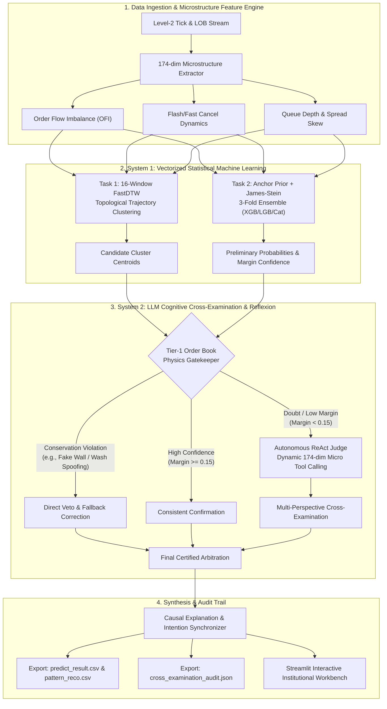

<div align="center">

# ⚡ Level2-Insight Agent

### Dual-System Autonomous Order Flow Microstructure & Causality Reflexion Framework
**A Next-Generation Quantitative Architecture Bridging High-Frequency Limit Order Book Dynamics with LLM-Driven Cognitive Cross-Examination**

[](https://www.python.org/)
[](https://opensource.org/licenses/MIT)
[](https://streamlit.io/)
[-green.svg)]()
[](https://github.com/psf/black)

[**English Overview**](#english-overview) | [**系统中文介绍**](#中文核心架构说明) | [**Architecture**](#system-architecture) | [**Quickstart**](#quickstart-guide) | [**Directory Layout**](#directory-structure)

</div>

---

## English Overview

**Level2-Insight Agent** is an institutional-grade quantitative research and market-participant intent detection framework designed for ultra-high-frequency Level-2 tick and limit order book (LOB) data in Chinese equity markets (A-shares).

Traditional quantitative machine learning pipelines (e.g., GBDT, XGBoost, CatBoost) suffer from critical vulnerabilities when analyzing microstructure order flow:
1. **Physical Conservation Violations**: Statistical models frequently hallucinate aggressive accumulation labels on stocks dominated by high-speed spoofing or flash cancellations (>80% cancel ratio within 500ms).
2. **Confidence Illusion**: High softmax/margin scores often obscure low-sample distribution shifts and order-flow imbalance (OFI) divergences.
3. **Black-Box Opacity**: Statistical scores fail to produce audit-compliant causal explanations required by institutional compliance and risk control committees.

**Level2-Insight Agent** solves these challenges by implementing Daniel Kahneman's **Dual-System Theory (System 1 + System 2)**:
* **System 1 (Vectorized Reflex Engine)**: Handles compute-intensive 174-dimensional order book feature engineering, 16-window FastDTW (Dynamic Time Warping) topological trajectory clustering, and James-Stein regularized tree ensembles.
* **System 2 (Cognitive Cross-Examination & Reflexion Agent)**: An autonomous LLM-driven adversarial judge that conducts **Tier-1 physical conservation filtering**, **Tier-2 dynamic tool retrieval (ReAct)**, and **cross-examination arbitration** to vet or override statistical predictions.

---

## 中文核心架构说明

**Level2-Insight Agent** 是针对 A 股高频 Level-2 Tick/逐笔委托与十档订单簿数据设计的**双系统（System 1 快思考 + System 2 慢思考）自主投研与市场参与者意图质证框架**。

### 为什么需要质证 Agent（Cross-Examination Agent）？
在金融高频微观结构领域，将整个百 GB 级高频数据预处理放入 LLM 工具链是非常不现实且低效的。因此本项目采用解耦架构：
1. **阶段 1 (System 1 - 机器计算)**：在毫秒级/秒级高并发下完成 174 维微观特征抽取（OFI 订单流不平衡、闪烁撤单率、微观价格偏度、深度分布等），并通过 16 窗口 FastDTW 拓扑聚类 (Task 1) 与 3 折集成树模型 (Task 2) 产出候选结果。
2. **阶段 2 (System 2 - 认知质证与反思)**：Agent 作为“首席合规与微观结构质证法官”，对初筛结果进行**因果倒查与微观物理定律守恒校验**：
   - **一票否决权（Physics Conservation Veto）**：若模型预测为“机构建仓”，但微观特征显示 3 秒内撤单率超过 75% 且主动买盘 OFI 为负，Agent 依据微观订单簿守恒律直接否决并纠正。
   - **动态调取深层特征（Tier-2 Tool Retrieval）**：当树模型预测置信度存疑（Margin < 0.15）时，自主触发 ReAct 工具调取全量 174 维截面 Z-Score 特征进行仲裁。
   - **因果叙事全自洽同步**：最终导出的行为模式解释（`pattern_explanation`）与资金意图（`capital_intention`）100% 依据最终判决自洽生成，杜绝前后矛盾。

---

## System Architecture



---

## Directory Structure

```text
level2-insight-agent/
├── agent/                       # System 2: Cognitive LLM Agent & Judicial Arbitrators
│   ├── context.py               # Macro/micro contextual feature loader & Z-Score normalizer
│   ├── judge.py                 # Multi-threaded CrossExaminationJudge & batch arbiters
│   ├── prompts.py               # Institutional financial ReAct system prompts & guardrails
│   └── tools.py                 # Sandboxed dynamic toolsets (cross-sectional metrics, OFI, etc.)
├── features/                    # High-frequency Level-2 microstructure feature engineering
│   ├── core.py                  # Order book fields, cancellation dynamics & OFI definitions
│   ├── features.py              # L1 daily aggregations, L3 intraday profiles & L4 sequence metrics
│   ├── main.py                  # End-to-end feature extraction engine & Parquet/CSV IO
│   ├── run_all.py               # Batch feature generation orchestrator
│   └── infer_features/          # Pre-extracted test and inference date slices (e.g., 7.10 - 7.22)
├── inference/                   # System 1: Machine learning inference & topology routing
│   ├── agentic_trainer.py       # 3-Fold XGBoost/LightGBM/CatBoost ensemble with EM refinement
│   ├── capital_graph.py         # Capital topological semantic graph builder
│   ├── dtw_clustering.py        # 16-Window FastDTW trajectory alignment & spectral clustering
│   ├── infer.py                 # Master pipeline orchestrating System 1 and System 2
│   └── loader.py                # Fast dataset & model artifact deserializers
├── models/                      # Pretrained topological centroids & ensemble scalers
│   ├── centroids.json           # Optimal FastDTW cluster trajectory centroids
│   └── task2_scaler.pkl         # Microstructure quantile normalizer
├── tests/                       # Unit tests, physical conservation tests & security audits
│   └── test_agent.py            # Comprehensive test suite (prompts, guardrails, fallback, critic)
├── training/                    # Offline training workflows
│   ├── train_task1.py           # FastDTW & Wasserstein topological cluster training
│   └── train_task2.py           # James-Stein prior calibration & tree ensemble training
├── web/                         # Interactive Quantitative Cockpit & Audit UI
│   └── app.py                   # Streamlit institutional investment research workbench
├── .env.example                 # Environment configuration template
├── .gitignore                   # Standard git ignore rules (protects API keys & large datasets)
├── config.py                    # Global configuration & dynamic path resolution
├── LICENSE                      # MIT Open Source License
├── main.py                      # CLI entrypoint for running pipelines, demos, and tests
└── requirements.txt             # Python dependencies
```

---

## Quickstart Guide

### 1. Installation

Ensure Python 3.10 or higher is installed:

```bash
# Clone the repository
git clone git@github.com:V4lu3/level2-insight-agent.git
cd level2-insight-agent

# Create and activate a virtual environment
python -m venv venv
# On Windows:
.\venv\Scripts\activate
# On Linux/macOS:
source venv/bin/activate

# Install dependencies
pip install -r requirements.txt
```

### 2. Configure Environment Variables

Copy `.env.example` to `.env` and configure your LLM provider credentials:

```bash
cp .env.example .env
```

Edit `.env`:
```ini
# OpenAI-compatible API Configuration (supports OpenAI, Claude, DeepSeek, Agnes, vLLM, etc.)
OPENAI_API_BASE=https://api.openai.com/v1
OPENAI_API_KEY=your_api_key_here
LLM_MODEL=gpt-4o-mini
```

*(Note: If no API key is provided, the framework gracefully falls back to deterministic rule-based order book physical conservation criticism).*

---

### 3. Usage & CLI Entrypoints

#### Run End-to-End Pipeline for a Specific Date
Execute the full two-stage pipeline for a given trading day (e.g. July 22):
```bash
python main.py --date 7.22
```

#### Run in Instant Fast-Demo Mode
Simulate pipeline execution with synthetic Level-2 microstructure order books:
```bash
python main.py --demo --fast
```

#### Run Interactive Streamlit Web Workbench
Launch the institutional quantitative research visualization cockpit:
```bash
streamlit run web/app.py
```

#### Run the Rigorous Test Suite
Run unit tests, prompt injection guardrail verifications, order book conservation critics, and live judge tests:
```bash
python main.py --test
```

---

## Key Quantitative Innovations

### 1. 16-Window FastDTW Topological Trajectory Alignment
Intraday institutional order flow dynamics do not evolve at constant velocities. Fixed Euclidean distances fail when institutional execution schedules vary across trading sessions. We formulate a **16-window multi-resolution FastDTW (Dynamic Time Warping)** metric coupled with Wasserstein barycenter clustering:

$$D_{\text{DTW}}(X, Y) = \min_{\pi} \sum_{(i,j) \in \pi} \|x_i - y_j\|_2$$

This isolates genuine algorithmic volume-accumulation curves from non-stationary noise.

### 2. James-Stein Shrinkage Calibration for Imbalanced Regimes
In extreme market regimes, small sample sizes induce massive variance in maximum likelihood estimators. We incorporate **James-Stein Bayesian shrinkage** to anchor noisy tree estimates towards global sector priors:

$$\hat{\theta}_{\text{JS}} = \left(1 - \frac{(k-2)\sigma^2}{\|y - \mu_0\|^2}\right)(y - \mu_0) + \mu_0$$

### 3. Order Book Physics Conservation Invariants
System 2 enforces non-negotiable physical constraints derived from Kyle (1985) and Cont et al. (2014):
* **OFI-Price Coherence**: If $\text{OFI} < 0$ and Quote Mid-Price drops, an accumulation label represents either a wash trade or a spoofing manipulation.
* **Flash Cancellation Asymmetry**: When $R_{\text{flash\_cancel}} = \frac{V_{\Delta t < 500\text{ms}}}{V_{\text{total\_cancel}}} > 0.65$, depth liquidity is deemed artificial phantom depth.

---

## Security & Ethical Guardrails

* **Zero Secret Leakage**: API credentials and private endpoints are strictly kept in local `.env` files and permanently excluded by `.gitignore`.
* **Prompt Injection Resilience**: Every user/market text input passes through strict regularized guardrails before reaching the LLM reasoning core.
* **Non-Custodial / Deterministic Fallbacks**: If external LLM network connectivity is interrupted, the pipeline automatically switches to deterministic rule-based conservation checking, ensuring zero runtime crashes in production trading environments.

---

## Contributing & License

Contributions, issues, and feature requests are welcome!
Please feel free to check the [issues page](https://github.com/V4lu3/level2-insight-agent/issues).

Distributed under the **MIT License**. See [LICENSE](LICENSE) for more details.
